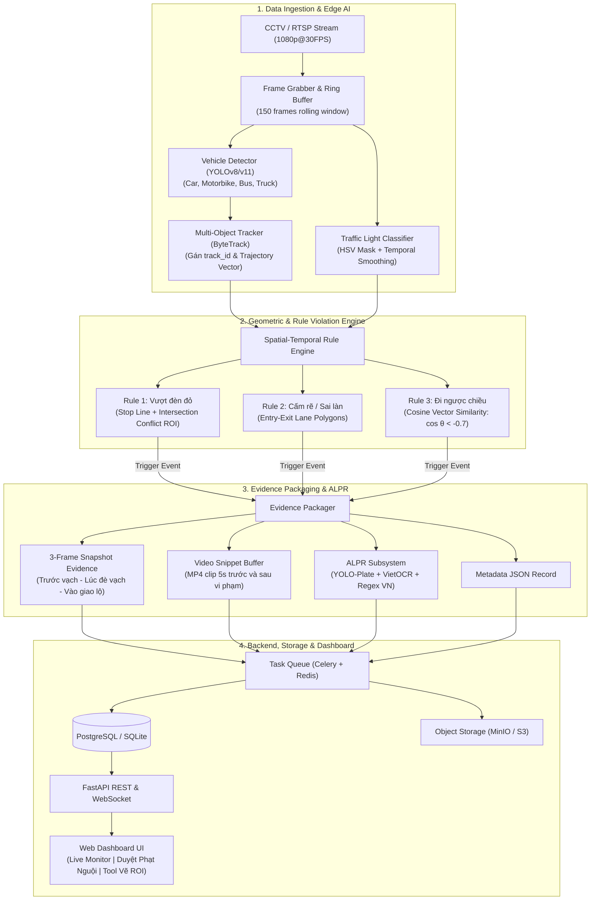

# 🚦 AI Smart Traffic Violation Detection & ALPR System
### Hệ Thống Giám Sát Giao Thông & Xử Lý Phạt Nguội Thông Minh Tại Ngã Tư

[](https://python.org)
[](https://fastapi.tiangolo.com)
[](https://github.com/ultralytics/ultralytics)
[](https://github.com/ifzhang/ByteTrack)
[](https://www.docker.com/)
[](LICENSE)

Hệ thống thị giác máy tính thông minh (Smart Traffic Video Analytics) tự động phát hiện, trích xuất bằng chứng pháp lý và lập biên bản phạt nguội các hành vi vi phạm giao thông phổ biến tại các nút giao/ngã tư theo thời gian thực (30–60 FPS):
1. 🔴 **Vượt đèn đỏ** (*Red-Light Running*)
2. 🔄 **Cấm rẽ nhưng vẫn rẽ / Đi sai làn** (*Illegal Turn & Non-Compliant Lane*)
3. ⛔ **Đi ngược chiều** (*Wrong-Way Driving*)
4. 🔍 **Tự động nhận diện biển số xe Việt Nam** (*Automatic License Plate Recognition - ALPR*)

---

## 🏛️ Kiến Trúc Hệ Thống (System Architecture)



---

## 📐 Giải Thuật Chi Tiết 3 Lỗi Vi Phạm & ALPR

### 1. Vượt đèn đỏ (Red-Light Running)
* **Đầu vào:** Vạch dừng $L_{stop} = (P_1, P_2)$, Đa giác giao lộ $Poly_{conflict}$, Trạng thái đèn từ ROI hộp đèn (`RED`, `YELLOW`, `GREEN`).
* **Giải thuật:**
  * Đoạn chuyển động giữa 2 frames gần nhất của tâm tiếp xúc mặt đường của xe $S_{motion} = (p_{t-1}, p_t)$.
  * **Điều kiện 1:** $S_{motion} \cap L_{stop} \neq \emptyset$ khi trạng thái đèn = `RED`.
  * **Điều kiện 2 (Khử bắt nhầm):** Tọa độ hiện tại $p_t \in Poly_{conflict}$ và khoảng cách vượt sâu vào giao lộ $d(p_t, L_{stop}) \ge 25\text{ px}$.
  * **Chống giật/phạt nhầm:** Có khoảng thời gian ân hạn (*Grace Period: 0.8s*); không phạt xe đã vượt vạch khi đèn vàng/xanh nhưng bị kẹt giữa giao lộ.

### 2. Đi ngược chiều (Wrong-Way Driving)
* **Đầu vào:** Vector quỹ đạo chuyển động của xe $\vec{v}_{veh} = (x_t - x_{t-k}, y_t - y_{t-k})$ và Vector hướng chuẩn của làn đường $\vec{v}_{lane}$.
* **Giải thuật:**
  * Tính góc Cosine giữa 2 vector:
    $$\cos(\theta) = \frac{\vec{v}_{veh} \cdot \vec{v}_{lane}}{\|\vec{v}_{veh}\| \|\vec{v}_{lane}\|}$$
  * **Điều kiện vi phạm:** $\cos(\theta) < -0.70$ (tức góc lệch $\theta > 135^\circ$) VÀ độ dịch chuyển $\|\Delta p\| \ge 30\text{ px}$ duy trì liên tục trong $N \ge 10$ frames liên tiếp.

### 3. Cấm rẽ / Đi sai làn (Illegal Turn & Non-Compliant Lane)
* **Đầu vào:** Đa giác làn tiếp cận $Poly_{lane}$ và danh sách hướng cho phép `allowed_directions` (ví dụ: `["STRAIGHT"]`).
* **Giải thuật:**
  * Xác định làn xuất phát khi xe vừa tiến vào khung hình.
  * Tính thành phần vận tốc ngang $v_x$ và dọc $v_y$. Nếu xe ở làn "Chỉ đi thẳng" nhưng vector chuyển động bẻ ngoặt $v_x < -0.55$ (rẽ trái trái phép) hoặc $v_x > 0.55$ (rẽ phải trái phép) $\to$ Kích hoạt vi phạm.

### 4. Tự động nhận diện biển số Việt Nam (ALPR)
* **Định dạng biển số:**
  * **Ô tô (1 dòng):** `29A-123.45`, `30F-999.99`, `51G-888.88`
  * **Xe máy (2 dòng):** `29-B1 123.45`, `43-K1 678.90`
* **Chuẩn hóa OCR:** Tự động sửa lỗi nhầm ký tự quang học (ví dụ: chữ `O`/`D` thành số `0`, chữ `I`/`L` thành số `1`, số `8` thành chữ `B`).

---

## 📁 Cấu Trúc Thư Mục Chuẩn Doanh Nghiệp

```text
traffic-violation-detection-system/
├── configs/
│   ├── app_config.yaml                  # Cấu hình toàn hệ thống (Inference, Redis, DB)
│   ├── camera_intersection_01.json      # Tọa độ hình học: Vạch Stop Line, Làn đường, ROI Đèn
│   └── dataset_classes.yaml             # Danh mục class phương tiện và format biển số
├── src/
│   ├── config.py                        # Pydantic v2 Settings quản lý biến môi trường
│   ├── data/                            # [MÔ-ĐUN 1] Data Engineering & Augmentation
│   │   ├── augmentation.py              # Albumentations pipeline (Mưa, Sương mù, Nắng chói, Rung)
│   │   ├── dataset_validator.py         # Kiểm tra tính toàn vẹn nhãn YOLO & ALPR
│   │   └── synthetic_generator.py       # Sinh luồng video ngã tư giả lập phục vụ kiểm thử CI/CD
│   ├── cv/                              # [MÔ-ĐUN 2] Core ML - Nhận diện, Theo vết & ALPR
│   │   ├── detector.py                  # Wrapper YOLOv8/v11 phát hiện phương tiện
│   │   ├── tracker.py                   # Multi-Object Tracking & Smoothing trajectory buffer
│   │   ├── traffic_light.py             # Phân loại trạng thái Đèn (HSV + Temporal Smoothing)
│   │   └── alpr/                        # Hệ thống con nhận diện biển số
│   │       ├── plate_detector.py        # Định vị vùng biển số xe
│   │       ├── ocr_engine.py            # Nhận diện ký tự OCR
│   │       └── plate_validator.py       # Regex chuẩn hóa biển số xe Việt Nam
│   ├── rules/                           # [MÔ-ĐUN 3] Logic Engine - Phát hiện 3 Lỗi Vi Phạm
│   │   ├── base_rule.py                 # Interface Base Rule & Data Model ViolationEvent
│   │   ├── red_light_rule.py            # Thuật toán bắt lỗi Vượt đèn đỏ
│   │   ├── wrong_way_rule.py            # Thuật toán bắt lỗi Đi ngược chiều (Cosine similarity)
│   │   ├── illegal_turn_rule.py         # Thuật toán bắt lỗi Cấm rẽ / Sai làn
│   │   └── rule_engine.py               # Bộ điều phối thực thi đồng thời tất cả các rules
│   ├── backend/                         # [MÔ-ĐUN 4] Evidence Packaging & Backend API
│   │   ├── video_buffer.py              # Circular Frame Ring Buffer trích xuất clip 5s
│   │   ├── evidence_packager.py         # Đóng gói 3 ảnh snapshot + crop biển số + metadata JSON
│   │   ├── celery_app.py & tasks.py     # Hàng đợi tác vụ nền Celery + Redis
│   │   ├── db/                          # Database Layer: SQLAlchemy Models & Session
│   │   └── api/                         # FastAPI REST API & WebSocket Server
│   └── dashboard/                       # [MÔ-ĐUN 5] UI/UX Dashboard
│       ├── templates/index.html         # Giao diện Live Monitor, Duyệt Phạt Nguội & Cấu hình ROI
│       └── static/                      # CSS Dark Theme & Canvas JavaScript app
├── scripts/
│   ├── run_pipeline.py                  # Chạy mô phỏng toàn bộ quy trình phát hiện vi phạm
│   ├── seed_demo_data.py                # Nạp dữ liệu vi phạm mẫu vào cơ sở dữ liệu
│   └── export_models.py                 # Xuất mô hình PyTorch sang ONNX / TensorRT FP16
├── tests/                               # Bộ Unit Tests & Integration Tests toàn diện
├── docker-compose.yml                   # Cụm microservices (App, DB, Redis, Celery, MinIO)
├── Dockerfile                           # Multi-stage production container
├── requirements.txt                     # Danh mục thư viện phụ thuộc
└── .env.example                         # File mẫu biến môi trường
```

---

## 🚀 Hướng Dẫn Cài Đặt & Chạy Nhanh (Quick Start)

### Cách 1: Chạy trực tiếp trên máy cục bộ (Local)

1. **Clone repository:**
   ```bash
   git clone https://github.com/Tuandayneee/traffic-violation-detection-system.git
   cd traffic-violation-detection-system
   ```

2. **Tạo và kích hoạt môi trường ảo (Virtualenv):**
   ```bash
   python -m venv venv
   # Windows:
   venv\Scripts\activate
   # Linux/macOS:
   source venv/bin/activate
   ```

3. **Cài đặt thư viện phụ thuộc:**
   ```bash
   pip install -r requirements.txt
   ```

4. **Nạp dữ liệu mẫu:**
   ```bash
   python scripts/seed_demo_data.py
   ```

5. **Khởi động FastAPI Server & Web Dashboard:**
   ```bash
   uvicorn src.backend.api.main:app --host 0.0.0.0 --port 8000 --reload
   ```
   * Mở trình duyệt truy cập: **`http://localhost:8000`** để xem Web Dashboard.
   * Tài liệu API tương tác (Swagger UI): **`http://localhost:8000/docs`**.

6. **Chạy luồng mô phỏng End-to-End Simulation:**
   ```bash
   python scripts/run_pipeline.py
   ```

---

### Cách 2: Triển khai toàn bộ với Docker Compose

Khởi chạy đồng thời 5 services (`app`, `postgres`, `redis`, `celery_worker`, `minio`):
```bash
docker compose up -d --build
```
Kiểm tra trạng thái các container:
```bash
docker compose ps
```

---

## 🧪 Kiểm Thử Tự Động (Automated Testing)

Toàn bộ hệ thống được bảo vệ bởi bộ unit test chặt chẽ:
```bash
pytest tests/ -v
```

---

## 🖥️ Tính Năng Web Dashboard

| Chức năng | Mô tả chi tiết |
| :--- | :--- |
| **Giám sát thời gian thực (Live Monitor)** | Luồng hiển thị RTSP với overlay HUD vẽ vạch dừng, polygon làn đường, bounding box phương tiện và đèn tín hiệu nhảy màu tự động. |
| **Thẩm định phạt nguội (Reviewer Portal)** | Cho phép cán bộ duyệt biên bản vi phạm: xem 3 ảnh bằng chứng, clip 5s, ảnh phóng to biển số và nhấn **Xác Nhận Phạt** hoặc **Bỏ Qua / Bắt Nhầm**. |
| **Công cụ cấu hình ROI (Interactive ROI)** | Kéo thả trực quan trên HTML5 Canvas để căn chỉnh vị trí vạch Stop Line và hướng lưu thông của từng làn ngay trên giao diện web. |

---

## 📄 Bản Quyền & Giấy Phép (License)
Dự án được phát hành theo giấy phép [MIT License](LICENSE).
Tác giả: **Tuandayneee**.
